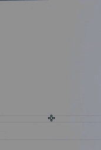

# 🎯 Crosshair — by.jkz



## Pourquoi pas de code de partage CS2 ?

Mon crosshair utilise `cl_crosshairgap_useweaponvalue true` — le gap s'adapte automatiquement selon l'arme équipée. Ce comportement est propre à chaque arme dans CS2 et ne se transfère pas fidèlement via le code de partage. Les commandes console ci-dessous garantissent un résultat 100% identique.

---

## Paramètres

| Paramètre | Valeur |
|---|---|
| Style | **2** — Statique classique |
| Taille | **1.5** |
| Gap | **-2** (s'adapte selon l'arme) |
| Gap useweaponvalue | **true** — comportement intentionnel |
| Épaisseur | **1** |
| Point central | **Non** |
| Contour | **Oui**, épaisseur 1 |
| Couleur | **Cyan** (R:50 G:255 B:255) |
| Alpha | **255** (opaque) |
| T-shape | **Non** |
| Recoil dynamique | **Non** |

---

## Commandes console — Copier-coller dans CS2

Ouvre la console CS2 (touche `` ` ``) et colle ces commandes :

```
cl_crosshairstyle 2
cl_crosshairsize 1.5
cl_crosshairthickness 1
cl_crosshairgap -2
cl_crosshairgap_useweaponvalue true
cl_fixedcrosshairgap -2
cl_crosshairdot false
cl_crosshair_drawoutline true
cl_crosshair_outlinethickness 1
cl_crosshaircolor 5
cl_crosshaircolor_r 50
cl_crosshaircolor_g 255
cl_crosshaircolor_b 255
cl_crosshairalpha 255
cl_crosshairusealpha true
cl_crosshair_t false
cl_crosshair_recoil false
```

**Share code** : `CSJSX2Drey3BAFbDPFiwGwnAeV8GmLAPNLHM9aqNAVyowM`

> Ces commandes sont à entrer manuellement dans la console ou via les fichiers `.vcfg` du dossier `cfg/`. Elles ne sont pas dans `autoexec.cfg` — le crosshair est géré par CS2 via tes fichiers userdata.

---

## Pourquoi ce crosshair ?

- **Style 2 statique** — ne bouge pas pendant le mouvement, idéal pour le placement de crosshair conscient
- **Gap -2** — crosshair très serré, précis pour les duels longue distance
- **Cyan (R:50 G:255 B:255)** — haute visibilité sur tous les environnements de maps compétitives
- **Contour activé** — reste lisible sur les fonds clairs (ciel, murs blancs)
- **Recoil false** — crosshair fixe, le spray control est appris manuellement
- **useweaponvalue true** — le gap s'adapte légèrement selon l'arme, ce qui donne un retour visuel naturel
